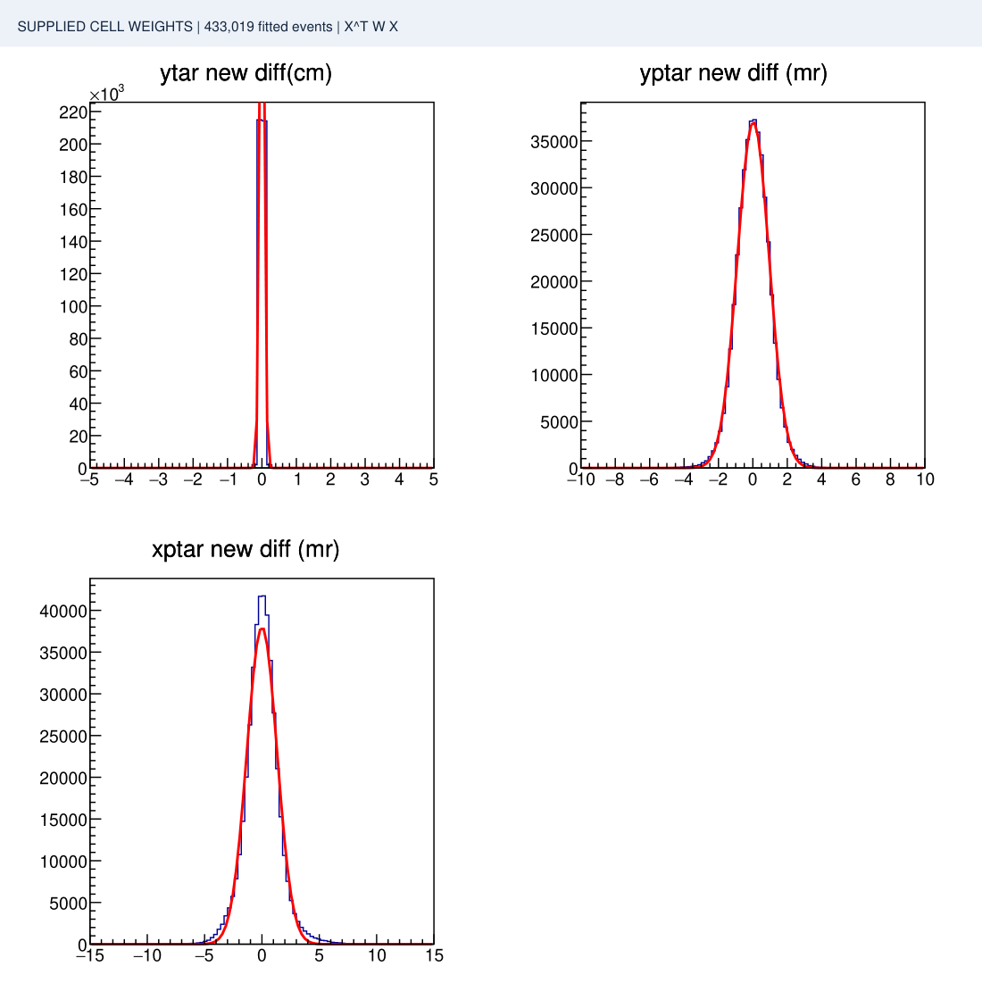
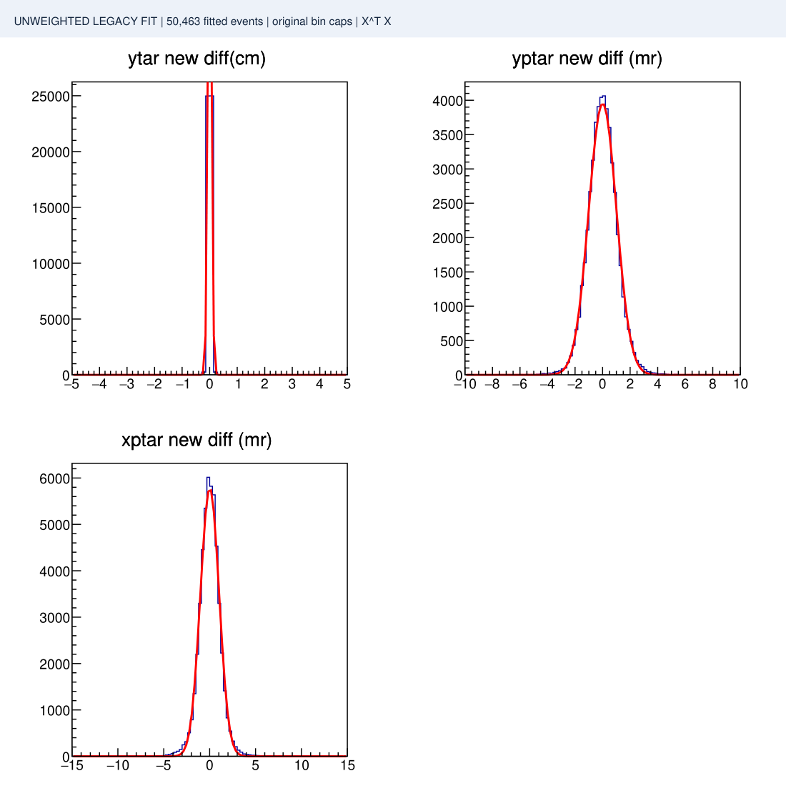

# SHMS run 25523: weighted and original unweighted SVD results

Two distinct fits are retained here. Every PDF page is labeled by its method.

| | [Supplied weights](weighted/REPORT.md) | [Unweighted legacy fit](unweighted/REPORT.md) |
|---|---|---|
| Solve | Adapted ROOT Xᵀ W X | **Original ROOT Xᵀ X; foil-total caps lifted** |
| Fitted events | 433,019 | 50,463, selected by original bin caps |
| Balancing | Equal occupied foil/hole/1%-delta cell weight | Original delta-by-sieve-column cap; no arbitrary foil-total limit |
| Holdout partition | None | None |
| External xptar/pphi offset for output matrix | **-0.0008681269905 rad, once** | **0; absorbed in fitted constant** |

The selection rules differ, so this is not an isolated weighting-only experiment.

## Open the results

| | Supplied weights | Unweighted legacy fit |
|---|---|---|
| Fitted matrix | [Matrix](weighted/matrices/nps_shms_newfit_25523_legacy.dat) | [Matrix](unweighted/matrices/nps_shms_newfit_25523_unweighted.dat) |
| Old residual summary | [PDF](weighted/plots/fit_opt_matrix_25523_legacy_old_matrix_diff.pdf) | [PDF](unweighted/plots/fit_opt_matrix_25523_unweighted_old_matrix_diff.pdf) |
| New residual summary | [PDF](weighted/plots/fit_opt_matrix_25523_legacy_new_matrix_diff.pdf) | [PDF](unweighted/plots/fit_opt_matrix_25523_unweighted_new_matrix_diff.pdf) |
| Full old diagnostics | [Folder](weighted/plots/old/) | [Folder](unweighted/plots/old/) |
| Full new diagnostics | [Folder](weighted/plots/new/) | [Folder](unweighted/plots/new/) |
| Numerical report | [JSON](weighted/fit_report.json) | [JSON](unweighted/fit_report.json) |

Both methods now have matching full legacy diagnostic suites under plots/old and plots/new. Within each method, those folders compare the two matrices at identical supplied xtarT inputs and on the same events: 433,019 for weighted and 50,463 for unweighted. The summary PDFs generated by each fitter use stored starting-replay residuals for old and fitted-matrix residuals for new. None is a fresh iterative HCANA replay.

## New-matrix residual previews

Supplied weights:

Unweighted legacy fit:

## Original fitter and compatibility

**[fit_opt_matrix_gmm.C](fit_opt_matrix_gmm.C)** is the original SHMS fitter from commit **3b93f6e**, with only two foil-total limits changed to the supplied input-row count. This avoids capping a single-foil dataset at 15000 events. The numerical XᵀX solve, ROOT truncation, original 1000-event delta-by-sieve-column cap, basis and fixed terms remain unchanged. The exact historical reference and two-line limit diff are included. This is the only executable fitting implementation in the current repository; supplied Python fitters and earlier adapted implementations are omitted. Prior Git history is preserved.

- [Exact source provenance](ORIGINAL_SOURCE.md)
- [Input compatibility changes](COMPATIBILITY_SUMMARY.md)
- [Unweighted result and original caps](unweighted/REPORT.md)
- [Earlier weighted adaptations](weighted/COMPATIBILITY_SUMMARY.md)

The historical fitter has no delta-only balancing switch: its bin cap is per delta-by-y-sieve-column bin. That bin cap and ROOT's default truncation remain unchanged; the foil-total caps are lifted for this one-foil input. No custom tolerance, column rescaling, new geometry correction or weighting function has been added to the original fitter.

The large event ROOT file is omitted. Its original SHA256 is e08ee264981ad9e571cb7326456d1f26274c91b6b3628d2007f42af76c084b0a. The only branch adaptation is converting ztarT to Double_t, with all values/order preserved. See run_unweighted.sh for reproduction using the supplied input.

Both fits use the same supplied weak labels and nominal single-foil geometry. Residual improvements do not independently validate physical labels or cross-run replay behavior.
